# Schoology Board

**Know what to do tonight without opening Schoology.** Paste your Schoology calendar link and Schoology Board opens on **Tonight**: how many things are due and how long they'll take, what to do first, and the order to do it in. Behind it are the **Board** (every assignment by status), **Calendar** (coming soon) and the **Sunday plan**. Seven looks to pick from, it works offline, installs like an app, and nothing is stored on a server.

**Live: https://schoology-board.vercel.app** · [See a sample plan](https://schoology-board.vercel.app) (no sign-in, made-up data)

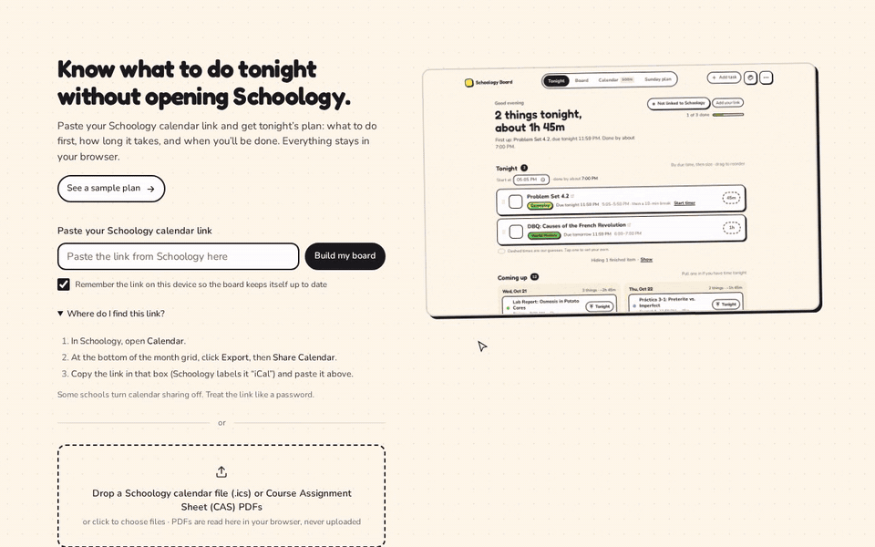

## What it does

- **Tonight (the home screen).** A one-line verdict ("3 things tonight, about 2h 15m"), then **Do first** (overdue work, pinned, with when it was due), then **Tonight**: your list in order (by due time, then biggest first) with planned times from the start time you pick, a 10-minute break after about 50 minutes, and when you'll be done. If it won't all fit before 11 PM, it says how many things won't fit instead of promising a time. Drag to reorder (hold on a phone, or use the arrow keys on the grip); **Back to suggested** undoes it. Check something off and it folds away with **Undo**. **Coming up** shows the next days with **Pull into tonight**. Nothing is hidden silently: finished items ("Hiding 2 finished · Show"), work more than two days late, and later days of Coming up are counted, with a link to the board.
- **Always honest about freshness.** A pill on every screen says "Synced with Schoology 3m ago". After 6 hours it turns yellow; if a refresh fails, a banner offers **Retry** and **Open Schoology** and keeps your list ("Your check-offs still save on this device"). Anything that looks off gets **Double-check this** with the reason, where it came from and an **It's right** button.
- **Time estimates.** Every task starts with a typical time for its kind (reading 30 min, homework 45, writing 60, lab 60; quizzes and tests get 60–90 min of study). Tap a time chip to pick 15 min to 2 h, or **More options…** to set any time or the kind of work. Dashed chips are guesses; solid ones are your average or your own number.
- **Timer.** Start and stop a timer on any task; the minutes come off tonight's plan. After you time two or more of the same kind of work in a class, the board uses your own average for that class.
- **Quizzes and tests.** Anything called a quiz or test (or marked as one) gets study sessions on the nights before it: 2 for a quiz, 3 for a test, 4 for a midterm or final.
- **Start early.** Work of 2 hours or more that's due in 3 to 5 days gets a **Start early** flag, and a 45-minute first chunk goes into tonight's list.
- **Sunday plan.** The coming Monday to Sunday (this week until Friday 6 PM, then next week): minutes of work due each day with the busiest day marked, quizzes and tests with their study nights, and big assignments to start early (2 hours or more, due in 3 to 5 days) with their first 45-minute chunk on tonight's list. **Share image** (or **Save image** where sharing isn't available) draws a picture of the plan in your current theme, right in your browser. The picture never includes your calendar link. No notifications.
- **The Board.** **Need to be done → Started → Completed** (plus an optional **Needs to be proctored** column), grouped by date (**Overdue**, **Today**, **Tomorrow**, then each day) with each card's class as a colored tag; **Filter → Group by class** switches to class groups (remembered). Drag cards (long-press on a phone), double-click to mark done, or use each card's **⋯** menu. Views: **Due today**, **Week** (from Friday 6 PM it opens on next week) and **All**.
- **Always up to date.** With a saved link the board updates when you open it, every 15 minutes while it's open, and when you come back to it after a few minutes. If Schoology doesn't answer, it keeps your saved board and quietly tries again later.
- **Install it.** On a Chromebook or Android phone use **Install app** in Chrome; on an iPhone use **Share → Add to Home Screen**. After the first visit it opens without internet.
- **Seven themes.** Sticker Book (the default), Arcade Night, Highlighter Notebook (light or dark), Varsity, Riso Zine, Lo-fi Café and Minimal (light or dark; no celebration, just a quiet strike-through and "Monday clear."), each with its own fonts, cards and finish moment. Pick one with the palette button (in **⋯** on a phone). Class colors come from each theme's 8 swatches and are saved per theme. Your theme is saved on this device and travels with backups and **Move to phone**.
- **Classes, even though Schoology doesn't send them.** After an import, **Name your classes** lists each group of assignments that start the same way ("ALG2 · 12 items") so you can name it once. Your Course Assignment Sheets (CAS) and your own edits always win.
- **Course Assignment Sheets.** Drop Course Assignment Sheet (CAS) PDFs. They're read in your browser and become dated tasks, including readings, which show up in Tonight with a reading estimate. Anything already on your Schoology calendar is skipped.
- **A clean start.** Work that was due before the day you made the board counts as already handled. A quiet note says how many are hidden, with **Show**.
- **Your own tasks and categories.** Add, rename, reorder or delete them; they survive every update.
- **Save a backup file** (in **⋯**). One `.html` file with your board, plan, estimates and theme inside. It works without internet. It never contains your calendar link.
- **Move this board to your phone** (in **⋯**). A QR code and a link carry your board, including estimates and timed minutes. Everything rides after the `#` in the link, which browsers never send to a server. The link includes your Schoology calendar link, so treat it like a password.
- **Import a backup file** (in **⋯**). Pick a backup `.html` or `.json`, then **Replace** or **Merge**.
- **Keyboard-friendly.** `N` add · `I` import · `/` search · `T`/`W`/`A` board views · `[` `]` weeks · `M` card menu · `X` done · `?` all shortcuts.
- **No notifications (yet).** See the note at the end.

| Board | First run |
|---|---|
| 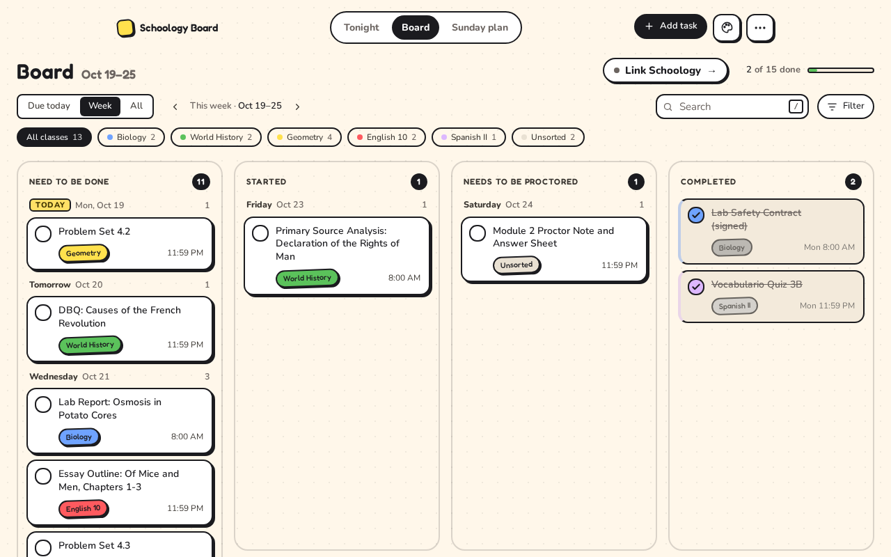 | 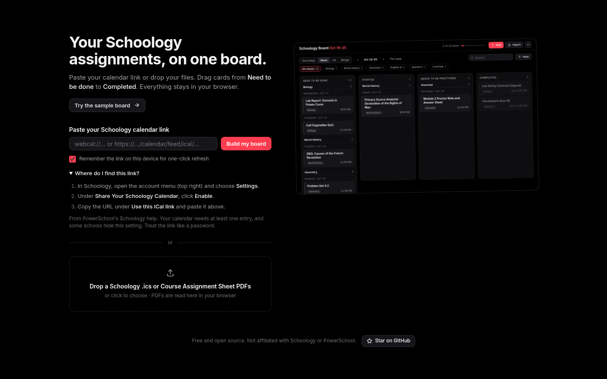 |
| **Course Assignment Sheet preview** | **A full (made-up) school year, mid-February** |
| 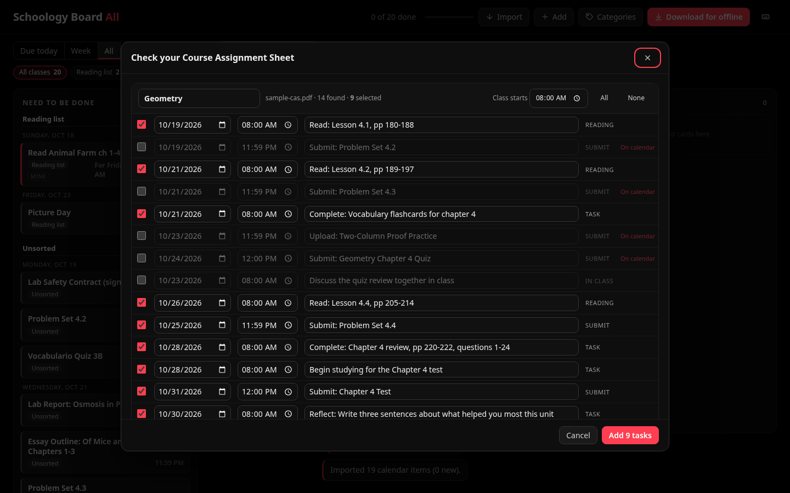 | 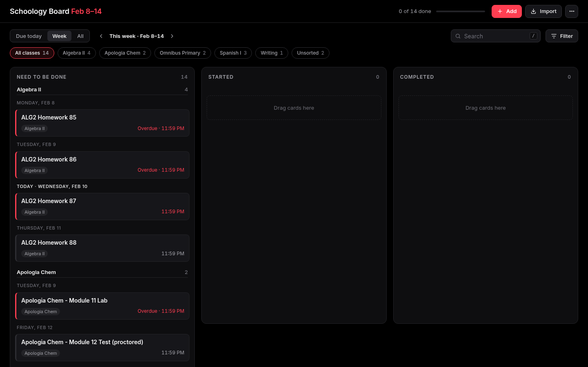 |
| **Name your classes (after an import)** | **Friday evening: Week shows next week** |
| 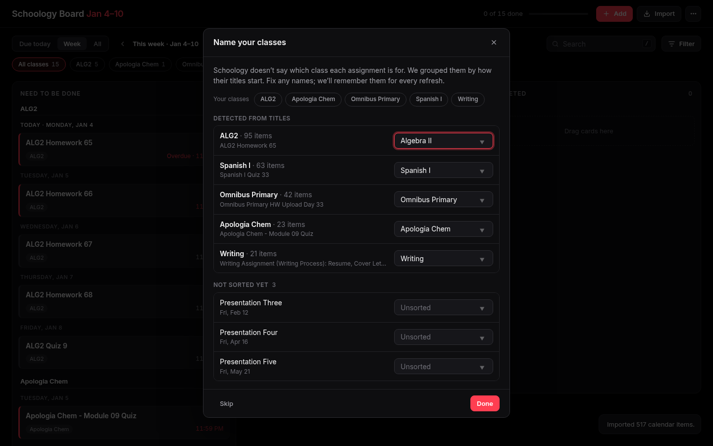 | 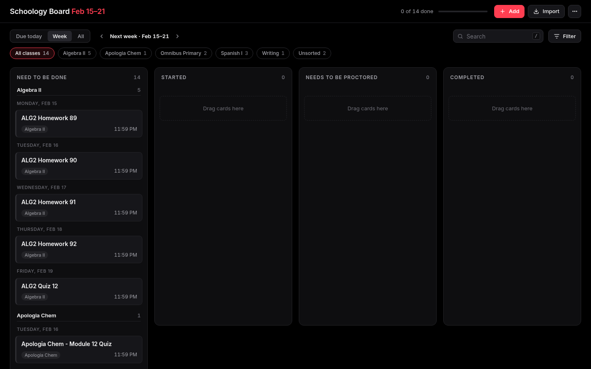 |
| **Move to phone** | **The phone after scanning** |
| 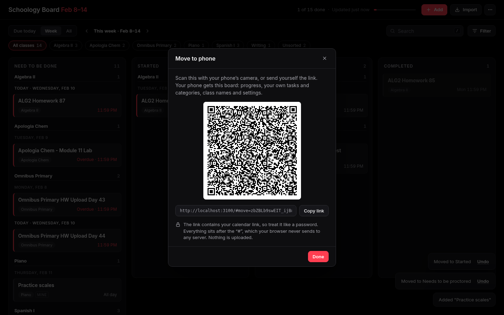 | 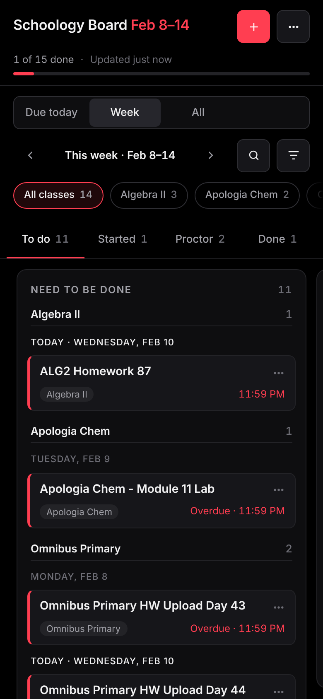 |

| Phone | Card menu on a phone |
|---|---|
| 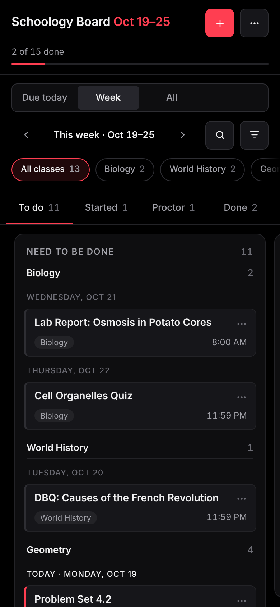 | 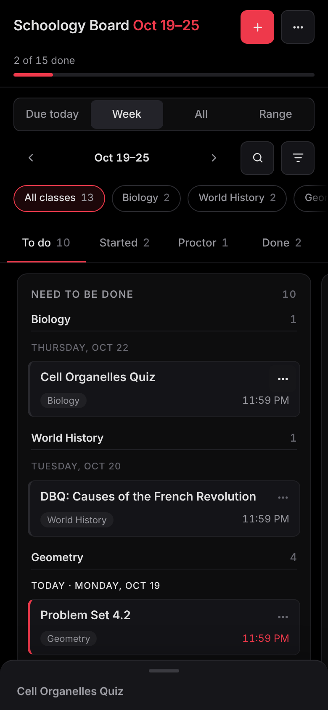 |

## Get your Schoology calendar link

Verified on a real student account:

1. In Schoology, open **Calendar**.
2. At the bottom of the month grid, click **Export**.
3. Choose **Share Calendar**.
4. Copy the link in that box (Schoology labels it "iCal") and paste it into Schoology Board.

Some schools turn calendar sharing off; if you don't see **Export** or **Share Calendar**, that's probably why. Treat the link like a password: anyone who has it can read your calendar.

**No link?** Drop a calendar file (it ends in `.ics`) instead. Any calendar app that subscribed to your Schoology calendar can usually export one.

## Privacy

- **Nothing is stored on a server.** Your board, progress, custom tasks and categories live in your browser's `localStorage` (or inside your backup file). The saved calendar link stays in this browser's `localStorage` and is only ever sent, in a POST body, to the relay.
- **The calendar proxy only relays.** Browsers can't read Schoology's feed directly (it has no CORS headers), so a tiny serverless route ([`app/api/feed/route.js`](app/api/feed/route.js)) fetches it and streams the bytes back. The link is sent in a POST body, so it never appears in a URL or request log. The route doesn't log, cache or store the link or the calendar. It refuses private network addresses and anything that isn't a calendar.
- **Course Assignment Sheet PDFs never leave your device.** They're read in the browser.
- **The installable app caches only the app itself.** Its service worker keeps the page, styles and scripts for offline use. It never caches calendar responses or anything with your link in it; your assignments live only in `localStorage`.
- The calendar link is kept only if you tick *Remember the link on this device*. It is **never** put into a backup file.
- **Move to phone links never touch a server.** The board rides in the URL fragment (`#move=…`), which browsers don't include in requests. The receiving page strips it from the address bar straight away. The QR code is drawn in your browser ([qrcode-generator](https://github.com/kazuhikoarase/qrcode-generator), MIT); no QR service is called.
- No analytics, no accounts, no cookies.

## What's in a Schoology calendar feed (and how it's parsed)

Schoology's feed is a standard iCalendar file. As far as we could verify:

- **`SUMMARY`** is the assignment or event title, by itself. Schoology doesn't put the course name in it.
- **`DTSTART`** is the due time, usually in UTC (`DTSTART;VALUE=DATE-TIME:20261020T035900Z` means 11:59 PM Eastern on Oct 19). All-day events use `VALUE=DATE`.
- **`URL;VALUE=URI:`** is the item's Schoology page (`…/assignment/<id>/…`, `…/event/<id>/…` and so on). `DESCRIPTION` ends with `" - Link: <same url>"`, which is used when `URL` is missing.
- **`UID`** is stable for each item, so progress is keyed on it.
- **There is no course field.** Classes are worked out as described above. Your edits always win and survive re-imports.

Real feeds also contain school events. Some carry audience tags in `CATEGORIES` or as a `(…)` title suffix ("Grades 7-12", "FT Students Only", "this week only"). Some are recurring (`RRULE`), and some span several days. Recurring events are expanded once each (with `EXDATE` and moved occurrences honoured). Multi-day events show once, on their start date. All-day dates never shift a day.

How we checked: Schoology's REST API docs (events vs. assignment due events, title/description fields), PowerSchool's calendar-sharing docs (the `/calendar/feed/ical/…` link), and open-source Schoology feed parsers on GitHub whose test fixtures and notes describe the same shape. The parser also copes with folded lines (including folds inside multi-byte characters), escaped `\,` `\;` `\n`, `TZID` and Windows zone names, floating times, `VALUE=DATE`, `DUE`, missing `UID`/`URL`, `STATUS:CANCELLED` and nested `VALARM`s.

## Run it yourself

```bash
npm install
npm run dev          # http://localhost:3000
npm test             # unit tests: calendar parsing, CAS, the planner, time zones/DST, theme + color + motion rules, a 517-item synthetic school year
npm run build && npm start
BASE_URL=http://localhost:3000 npm run test:e2e   # headless Chromium end-to-end (frozen clock)
BASE_URL=http://localhost:3000 node scripts/perf-now.mjs      # time-to-content on a throttled phone
BASE_URL=http://localhost:3000 node scripts/record-demo.mjs   # re-record docs/demo.gif (needs ffmpeg)
```

Deploy to Vercel as a standard Next.js project; no environment variables are needed.

### How it's built

- `public/board/theme/*.css`: the seven themes as CSS variables (with their fonts in `theme/fonts/`, SIL OFL); `default.css` maps them onto the layout's variables. `board.css` and `tonight.css` only reference variables. See [THEMING.md](THEMING.md).
- `public/board/board.js`, `board.css`, `tonight.css`: the whole UI, framework-free. The website (`public/index.html`) and the backup file run **the same files**. The backup inlines them along with pdf.js.
- `public/board/plan.js`: the planner (estimates, learning, tonight's time blocks, study nights, start-early, week ahead). Pure functions, unit-tested with frozen clocks.
- `scripts/build-pwa.mjs`: writes the app manifest and service worker at build time (colors from the theme).
- `public/board/ics.js`: the iCal parser (no dependencies; runs in the browser and Node).
- `public/board/cas.js`: the CAS parser. It works on pdf.js text positions: it finds the *Class Dates* and *Assignments* columns, assigns each task to its class day (including rows that run onto the next page), and pulls out explicit due dates like "Due Saturday 09/12/26 at 12:00 pm ET" or "by midnight the evening prior to class".
- `app/api/feed/route.js`: the calendar relay (Next.js route handler).
- Tests: `test/ics.test.mjs`, `test/cas.test.mjs`, `test/year.test.mjs` and `test/e2e.mjs`. Fixtures are all made up: `public/sample/schoology-sample.ics`, `test/fixtures/messy.ics`, `test/fixtures/sample-cas.pdf`, and `test/fixtures/year.ics` (Aug–Jun, generated by `make-year-feed.mjs` together with an independently computed `year-expected.json`). The end-to-end run checks the exact Due today / This week / per-column / per-class counts for that year. To check the CAS parser against your own sheets without committing them: `CAS_SAMPLES_DIR=~/Downloads npm test`.

## Why no notifications

Reminders would need push notifications. Web push needs a server that stores each device's push subscription and a scheduler that wakes up to send them, which conflicts with the rule that nothing about you is stored on a server. A phone can't reliably schedule its own reminders from a web page either. Possible later options: let the installed app show a reminder only while it's open, or offer an opt-in calendar file of study sessions that your phone's own calendar app reminds you about.

## License

MIT. Not affiliated with Schoology or PowerSchool.
